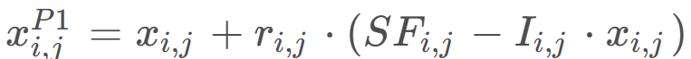
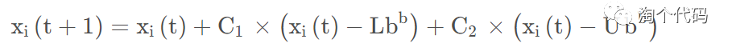
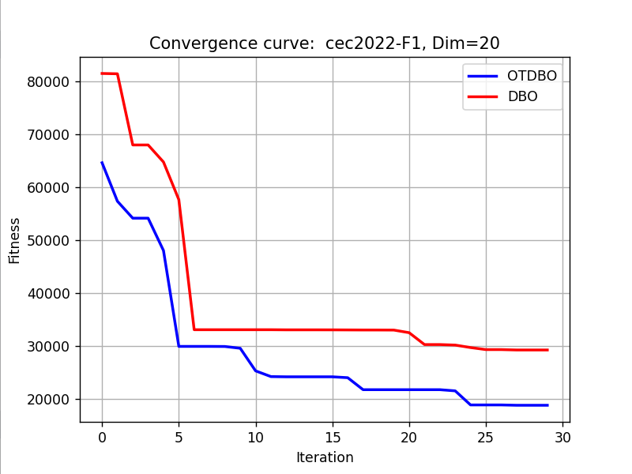
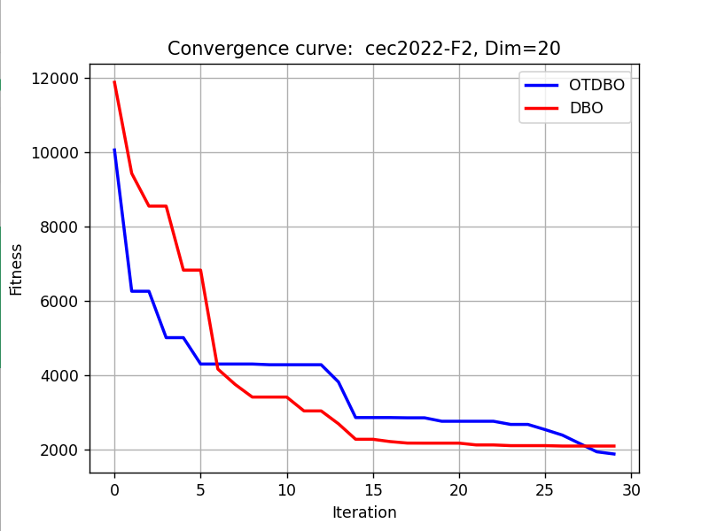

# Improved Dung Beetle Python (Fish Hawk Algorithm + t-distribution)

The content and innovation points of this issue are sufficient to support the writing of a paper! Those who need it, please download quickly to obtain the code.
The integration of eagles and adaptability introduced in this issue.tDistributed Dung Beetle Optimization Algorithm(OTDBO), It was the result of the author's careful consideration of the original formula principle of the ant colony algorithm, and it took a long time to study..  
Detailed Explanation of Improvement Strategies
Logistic chaotic mapping
In the section on chaotic mapping, the most classic Logistic chaotic mapping is still used. The main purpose is to increase the diversity of initialization for intelligent algorithm particles. If you want to replace it with other chaotic mappings, you can refer to this article: 10 Chaotic Mapping Optimization Grey Wolf Algorithm, which can be switched at one click.
② Integration of the Fish Hawk Optimization Algorithm
The fish eagle optimization algorithm is used to replace the original ant swarm's position update formula in the first stage of global exploration strategy. The original ant swarm's position update formula is as follows:
Among them, k is a perturbation coefficient in the range (0, 0.2], b is a random number between 0 and 1, and α takes -1 or 1. Xw represents the worst position globally.
The global exploration strategy of the fish eagle optimization algorithm can compensate for the Dung Beetle algorithm's reliance on the worst value in rolling behavior. Cannot communicate with other Dung Beetle in a timely manner. And the disadvantages of having many parameters. The global exploration strategy of the fish eagle algorithm randomly detects one fecal ball's position and rolls it. The global exploration strategy formula of the eagle optimization algorithm in the first stage is as follows:
③ Adaptive t-distribution perturbation strategy
T-distributed disturbance is applied to the foraging behavior of small Dung Beetle during their foraging phase. The original formula for the foraging behavior of small Dung Beetle is as follows:
The iterative number variation formula is adopted.tDistribution's degree of freedom parametertDistributed mutation disturbances are introduced to perturb the foraging behavior of small Dung Beetle, enabling the Dung Beetle Algorithm to exhibit good global exploitation capabilities in the early iteration stages and good local exploration abilities in the later ones. This enhances the convergence speed of the algorithm. The specific position update method is as follows::   
Among them, t(C_iter) has undergone a variant.
The required package is:
matplotlib~=3.8.2\nnumpy~=1.26.3\nscipy~=1.12.0\nopfunu~=1.0.1\nResults display  
Utilizing the powerful opfunu library in Python, it integrates 11 CEC function libraries such as CEC2005/2008/2010/2013.

## Images

<!-- PAYMENT_BLOCK -->

## Get this dataset

- Payment link (Stripe): [Buy now](https://buy.stripe.com/3cs8yP7sY87d0vu9AB)
- Payment QR code: 

<!-- /PAYMENT_BLOCK -->
